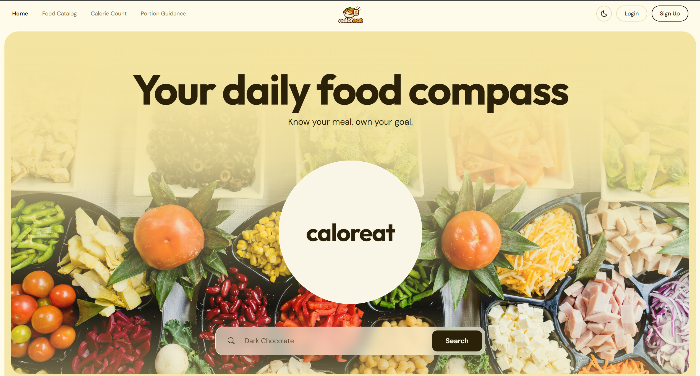
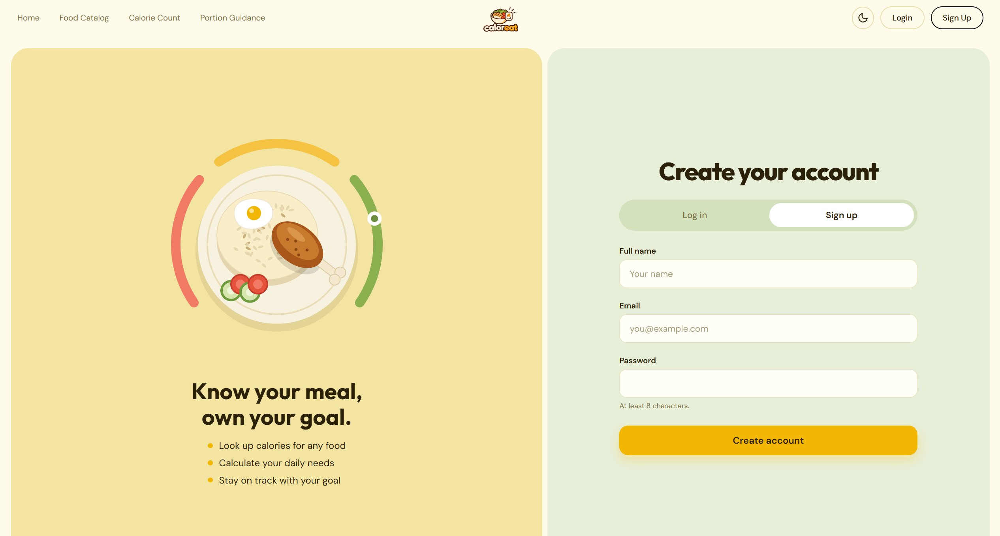
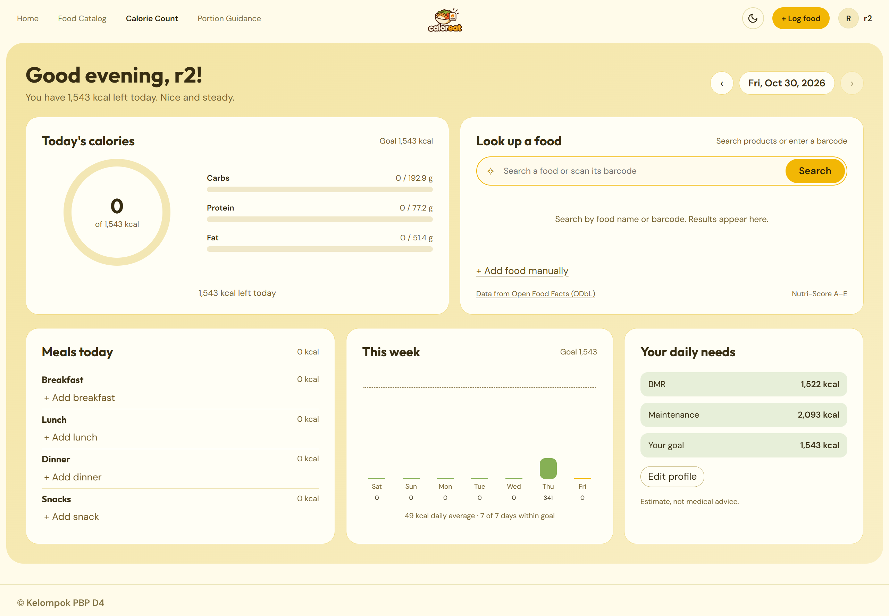
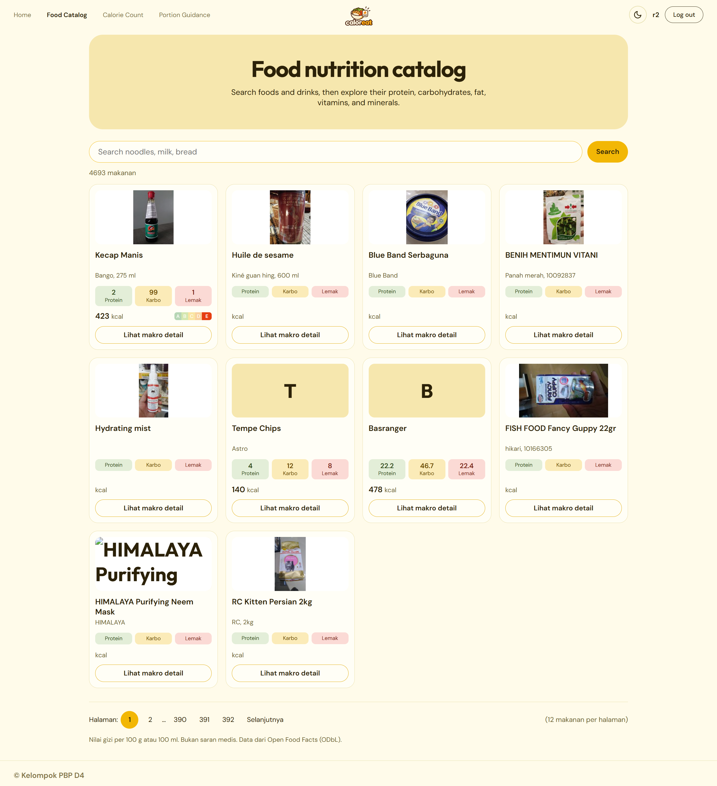
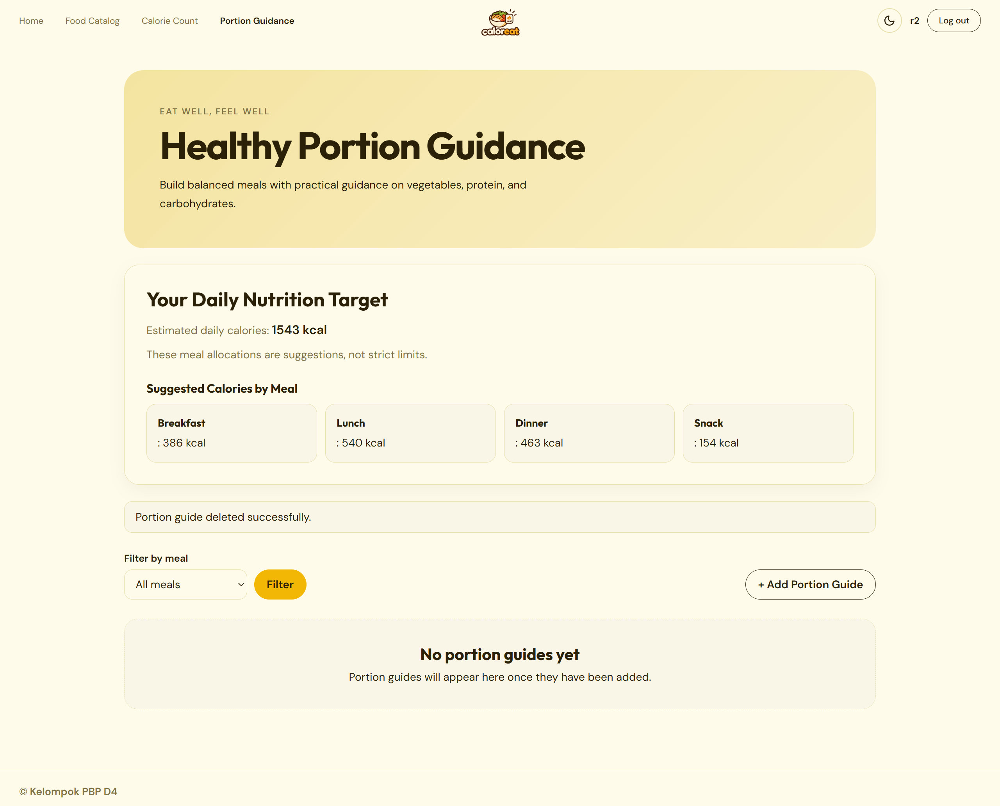
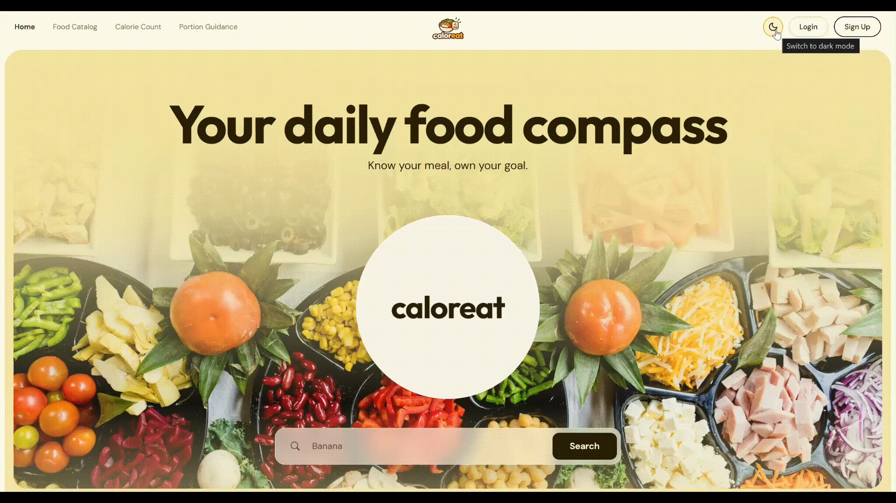

# Anggota Kelompok
2506584893 - Andranu Dhawy Purditya

2506592125 - Nathanael Orrick Hatmoko

2506612814 - Samuel Haganta Surbakti

2506618881 - Muhammad Fachri Novelino

2506656936 - Kusuma Putra Abdillah Adhimaya

# Deskripsi Website:
CALOREAT adalah platform kalkulator dan pemantau nutrisi harian yang membantu pengguna menghitung calorie intake secara presisi sekaligus memahami kandungan gizi pada makanan. Mengusung prinsip Sustainable Living, CALOREAT tidak hanya berfokus pada target kesehatan personal pengguna, tetapi juga mengedukasi dampak emisi karbon (carbon footprint) dari pilihan makanan harian agar pengguna dapat mengambil keputusan konsumsi yang lebih bijak dan ramah lingkungan.

Tak hanya sekadar pelacak kalori, CALOREAT menyediakan panduan takaran porsi makan yang ideal untuk memenuhi kebutuhan gizi tanpa memicu pembelian berlebih. Melalui integrasi katalog nutrisi dan panduan porsi harian, CALOREAT memudahkan pengguna menjaga berat badan ideal sekaligus berkontribusi aktif dalam mengurangi food waste, menciptakan ekosistem gaya hidup sehat yang berkelanjutan bagi tubuh dan bumi.

# Public API
Public API yang kami gunakan bersumber dari basis data Open Food Facts: [https://id.openfoodfacts.org/]


# Daftar Modul

- Halaman Autentikasi, Profil dan Admin Portal: Halaman login, register, profil pengguna, dan admin portal untuk mengelola pengguna serta basis data makanan. (Samuel Haganta Surbakti)

- Homepage & Navbar: Halaman utama yang menampilkan fitur-fitur unggulan website, edukasi singkat pola makan sehat, Reviews dari pengguna, beserta Navbar. (Andranu Dhawy Purditya)

- Kalkulator & Pelacak Kalori: Pengguna dapat menghitung kebutuhan kalori harian (BMR/TDEE) serta mencatat asupan makanan harian secara teratur. (Nathanael Orrick Hatmoko)

- Katalog Nutrisi Makanan: Menyajikan daftar bahan dan menu makanan beserta detail informasi kandungan gizi sehat seperti makronutrisi (protein, karbohidrat, lemak) dan mikronutrisi (vitamin, mineral). (Muhammad Fachri Novelino)

- Panduan Porsi Makan Sehat: Menyajikan panduan takaran dan ukuran porsi makanan yang ideal untuk dikonsumsi harian sesuai kebutuhan gizi pengguna. (Kusuma Putra Abdillah Adhimaya)


# Role Pengguna

- Belum login: Dapat melihat halaman homepage, berita edukasi, mengakses katalog makanan, dan melihat reviews pengguna lain

- login sebagai pengguna: Dapat mengakses kalkulator kalori, melengkapi profil, mengakses katalog nutrisi, panduan porsi makan sehat, menambahkan, mengedit, menghapus, dan memfilter review milik masing-masing.

- login sebagai admin: Dapat merubah/menambahkan informasi pada katalog nutrisi dan panduan makan sehat, serta menghapus reviews dari seluruh pengguna lain.

# Tautan Penting
- Link Figma : https://www.figma.com/design/V68iKwXFe8rn1on5zE9wi6/Caloreat?node-id=0-1&t=RW25UIKrE2cFGLEP-1
- Aplikasi (PWS Deployment): https://muhammad-fachri54-caloreat.pws.cs.ui.ac.id

# Tampilan Aplikasi 

| Homepage & Reviews | Halaman Autentikasi (Login & Register) |
| :---: | :---: |
|  |  |

| Katalog Nutrisi Makanan | Kalkulator & Pelacak Kalori |
| :---: | :---: |
|  |  |

| Panduan Porsi Makan Sehat |
| :---: |
|  |

| Dark Theme |
| :---: |
|  |

## Calorie Count

The authenticated `/calorie-count/` page supports food search and barcode lookup through a server-side Open Food Facts client, personal calorie targets, daily meal entries, and a seven-day summary. Data is isolated by account.

The JSON API is available at `/api/foods/search/`, `/api/foods/barcode/<code>/`, `/api/entries/`, `/api/entries/<id>/`, `/api/summary/`, `/api/summary/week/`, and `/api/profile/`. Mutating requests use the session cookie and Django CSRF token. Open Food Facts search responses are cached for 24 hours, and requests are throttled to stay within its search limits. The lookup credits [Open Food Facts](https://id.openfoodfacts.org/) under the ODbL.

After updating, apply the database migration with `python manage.py migrate`. To use a non-default contact for the Open Food Facts User-Agent, update `USER_AGENT` in `main/off.py` before deployment.

# Setup Guide

## Prasyarat (Prerequisites)
Pastikan perangkat Anda telah terinstal:
- **Python**
- **Git**
- **Google Chrome** (opsional, untuk menjalankan pengujian E2E dengan Selenium)

---

## 1. Clone Repositori
```bash
git clone https://github.com/pbp-kelompok-d4/CALOREAT.git
cd CALOREAT
```

## 2. Buat & Aktifkan Virtual Environment
**Windows (PowerShell / CMD):**
```powershell
python -m venv env
.\env\Scripts\activate
```

**macOS / Linux:**
```bash
python3 -m venv env
source env/bin/activate
```

## 3. Instal Dependensi
```bash
pip install -r requirements.txt
```

## 4. Konfigurasi Environment Variables (`.env`)
Buat file `.env` di direktori utama (*root*) proyek.

- **Untuk Development Lokal (SQLite - Default):**
  ```env
  PRODUCTION=False
  E2E_USER_PASSWORD=your_test_user_password
  E2E_ADMIN_PASSWORD=your_test_admin_password
  ```
- **Untuk Production (PWS):**
  ```env.prod
  PRODUCTION=True
  DB_NAME=your_db_name
  DB_USER=your_db_user
  DB_PASSWORD=your_db_password
  DB_HOST=your_db_host
  DB_PORT=5432
  SCHEMA=public
  ```

## 5. Migrasi Database
Jalankan migrasi untuk membuat tabel database:
```bash
python manage.py migrate
```

## 6. Jalankan Server Development
```bash
python manage.py runserver
```
Buka browser dan akses aplikasi di `http://127.0.0.1:8000/`.

---

## Menjalankan Pengujian (Testing)

### Unit Tests
```bash
python manage.py test
```

### End-to-End (E2E) Selenium Tests
Pastikan server Django sedang berjalan di `http://127.0.0.1:8000` serta variabel `E2E_USER_PASSWORD` dan `E2E_ADMIN_PASSWORD` sudah diatur di `.env`, lalu jalankan di terminal terpisah:
```bash
python e2e_reviews_test.py
```

# Project Structure

```text
CALOREAT/
├── caloreat/                       # Konfigurasi utama proyek Django
│   ├── __init__.py
│   ├── asgi.py
│   ├── settings.py                 # Pengaturan aplikasi, database, cache, dan static files
│   ├── urls.py                     # Routing URL tingkat proyek
│   ├── views.py
│   └── wsgi.py
├── main/                           # Aplikasi utama (modul fitur CALOREAT)
│   ├── fixtures/
│   │   └── off_products.json       # Data fixture produk Open Food Facts untuk pengujian
│   ├── migrations/                 # File migrasi skema database & tabel cache
│   ├── admin.py                    # Konfigurasi Django Admin
│   ├── apps.py
│   ├── calorie_views.py            # View & endpoint JSON API untuk Calorie Count
│   ├── catalog_views.py            # View untuk Katalog Nutrisi Makanan
│   ├── forms.py                    # Definisi form Django (Review, PortionGuide, dll.)
│   ├── models.py                   # Model database (Reviews, CalorieProfile, FoodEntry, PortionGuide)
│   ├── off.py                      # Klien API Open Food Facts (pencarian & barcode dengan caching)
│   ├── portion_views.py            # View CRUD untuk Panduan Porsi Makan Sehat
│   ├── test_calorie.py             # Unit tests modul Calorie Count
│   ├── test_portion_guidance.py    # Unit tests modul Portion Guidance
│   ├── test_reviews.py             # Unit tests modul Reviews
│   ├── tests.py                    # Unit tests umum & autentikasi
│   ├── urls.py                     # Routing URL aplikasi main
│   └── views.py                    # View halaman utama (Landing Page), autentikasi, & AJAX Review
├── static/                         # Aset statis (CSS, Gambar, JavaScript)
│   ├── css/                        # CSS
│   │   ├── add_object_style.css
│   │   ├── auth.css
│   │   ├── calorie_count.css
│   │   ├── catalog.css
│   │   ├── dark_theme.css
│   │   ├── input.css               # Entrypoint Tailwind CSS
│   │   ├── output.css              # Hasil build Tailwind CSS
│   │   ├── portion_guidance.css
│   │   ├── style.css
│   │   └── toast.css
│   ├── img/                        # Aset gambar 
│   └── js/                         # JavaScript
│       ├── auth.js
│       ├── calorie_count.js
│       ├── catalog.js
│       ├── collapse.js
│       ├── food_search.js
│       ├── navbar.js
│       ├── portion_guidance.js
│       ├── reviews.js
│       └── toast.js
├── templates/                      # Template HTML Django
│   ├── components/
│   │   ├── add_reviews_form.html   # Modal/form tambah & edit review
│   │   └── portion_guide_list.html # Komponen daftar panduan porsi
│   ├── authentication.html         # Halaman Login & Register
│   ├── base.html                   # Layout dasar aplikasi
│   ├── calorie_count.html          # Halaman Kalkulator & Pelacak Kalori
│   ├── catalog.html                # Halaman Katalog Nutrisi Makanan
│   ├── footer.html                 # Komponen footer
│   ├── header.html                 # Komponen navigasi (navbar)
│   ├── index.html                  # Halaman utama (Homepage, About, Education, & Reviews)
│   ├── portion_guidance.html       # Halaman Panduan Porsi Makan Sehat
│   └── portion_guidance_form.html  # Form tambah/edit Panduan Porsi (Admin)
├── .env                            # Variabel environment 
├── .gitignore
├── e2e_reviews_test.py             # Script pengujian End-to-End (E2E) menggunakan Selenium
├── manage.py                       # Utilitas CLI manajemen proyek Django
├── package.json                    # Konfigurasi script npm & dependensi Tailwind CSS
└── requirements.txt                # Daftar dependensi paket Python
```
